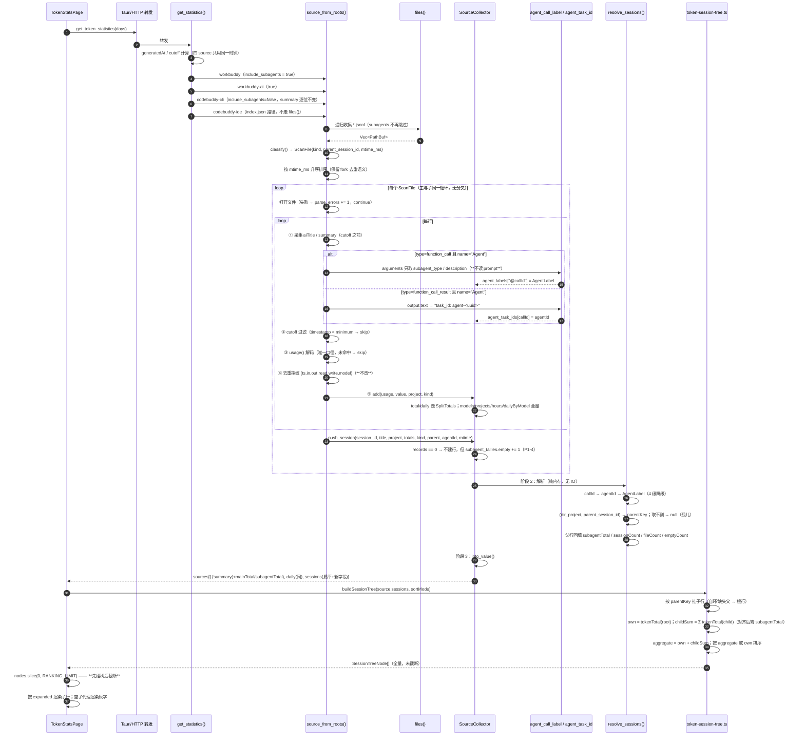
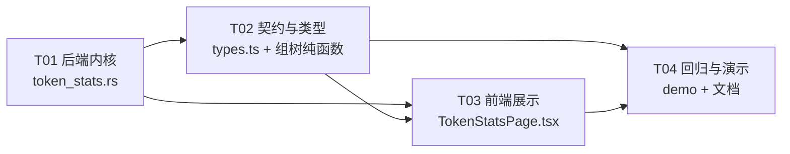

# 架构设计：Token 统计纳入子代理 + 主会话/子代理分项查看

| 项 | 内容 |
| --- | --- |
| 设计者 | 架构师 高见远 |
| 输入 | `docs/prd-token-subagents.md`（PM Alice） |
| 目标版本 | P0 全量（D1~D6）+ P1（排序口径 / 标签 / 空子代理计数） |
| 涉及文件 | `crates/wb-switch-core/src/modules/token_stats.rs`、`src/lib/types.ts`、`src/lib/token-session-tree.ts`（新增）、`src/pages/TokenStatsPage.tsx`、`src/lib/screenshot-demo.ts` |
| 不涉及 | 数据库、迁移、服务端依赖、`codebuddy-cli` / `codebuddy-ide` 的行为 |

---

## 0. 实测校验与对 brief 的两处修正

在写设计前我重新跑了一遍本机数据（`~/.workbuddy/projects/**`，2026-11-12）。**结论与 PRD 一致**，但有两条实现细节必须修正，否则会写出错误代码。

### 0.1 修正一：`_meta.baggage` **不能**作为父会话归属的兜底来源

brief 说「子代理记录 `_meta.baggage` 里有 `codebuddy.session_id=<父会话 id>`（兜底）」。**实测 40 个子代理文件里只有 12 个成立**，另外 28 个（含本次任务所在的 `9709836e-…` 会话）的 baggage 里装的是**子代理自己的** session id：

| 会话 | 子代理文件 | `record.sessionId` | `baggage.codebuddy.session_id` | 等于父 id？ |
| --- | --- | --- | --- | --- |
| `f7b5d1d9-…` | `agent-42a020df-….jsonl` | `01a1a50f-…` / `agent-42a020df-…` | `f7b5d1d9-…` | ✅ |
| `9709836e-…` | `agent-eb2b4040-….jsonl` | `01a1ceb2-b7cb-71fa-982c-4fbca1710f37` | `01a1ceb2-b7cb-…` | ❌（是子代理自己） |

**结论**：父归属**只认路径** `<project>/<parentSessionId>/subagents/agent-<uuid>.jsonl`。baggage 仅在「路径里取不到父目录」时作为最后兜底，且**必须校验 `baggage 值 ≠ 本文件记录的 sessionId`** 才接受（否则会把子代理挂到自己身上，产生自环）。这条修正已写进 §3.2 与 §9 风险表。

### 0.2 修正二：子代理文件的 `sessionId` 不是稳定的 `agent-<uuid>`

同一个文件里可能同时出现两种值（`01a1ceb2-…` 与 `agent-eb2b4040-…`），且**都与文件 stem 不一定相同**。所以：

- 行的 `session_id` / `agentId` 一律取 **文件 stem**（`agent-<uuid>`），它才是与父会话 `task_id` 对齐的稳定键。
- 记录里的 `sessionId` 字段**不参与**任何归属或去重逻辑。

### 0.3 复核基线（本机 2026-11-12，未叠加 fork 去重）

| 指标 | 主会话 | 子代理 | 说明 |
| --- | --- | --- | --- |
| 文件数 | 47（其中 13 个 0 条 usage） | 40 | 放开过滤后 `filesScanned` = 87 |
| 磁盘字节 | 443.0 MB | 49.9 MB | 子代理仅占 **+10.1%** 字节 |
| usage 记录 | 28 212 | 2 976 | 子代理占 **+9.5%** 记录 |
| 全时段 total | 8 904 M | 415 M | 子代理占 **4.4%** ✅ 与 PRD 一致 |
| 今日 total | 102.7 M | 136.0 M | 子代理占 **57%** ✅ 与 PRD 的 61.6% 同量级 |
| 空用量子代理文件 | — | **0** | P1-4 无自然样本，必须造 fixture |

> 性能结论：文件打开数 +85%，但字节只 +10%、记录只 +9.5%，解析成本几乎不变。**秒级扫描结论成立**，无需并发、无需缓存。

### 0.4 已确认的关联链路（D3 的实现依据）

父会话 `9709836e-….jsonl` 里：

```
type:"function_call"        name:"Agent"  callId:"call_00_x6kQ…"
  arguments = "{\"description\":\"设计子代理统计架构\",\"name\":\"software-architect\",
                \"prompt\":\"……正文，禁止读取……\",\"subagent_type\":\"software-architect\"}"
type:"function_call_result" name:"Agent"  callId:"call_00_x6kQ…"
  output = { type:"text",
             text:"Spawned successfully.\nagent_id: software-architect@software-token-stats\n
                   name: software-architect\nteam_name: software-token-stats\n
                   task_id: agent-eb2b4040-0f09-4851-8a0b-651a56d712db\n…" }
```

`task_id: agent-eb2b4040-0f09-4851-8a0b-651a56d712db` **逐字等于**子代理文件 stem。5/5 可关联已复现。

⚠️ 三个坑：
1. `arguments` 是 **JSON 字符串**（不是对象），必须二次解析；某些版本可能已是对象，两种都要兼容。
2. `output` 是 `{type:"text", text:…}`，也可能是裸字符串或数组，三种形态都要兜。
3. `output.text` 里同时有 `agent_id: software-architect@software-token-stats`——**绝不能**用它当 agentId（它不是文件 stem），只取 `task_id:` 那一行。
4. 子代理文件内**没有** `aiTitle` / `summary`，也**没有**嵌套的 `Agent` 调用（实测 0），也没有 `subagents/*/subagents/` 嵌套目录——放开过滤不会重复扫描，PRD 的假设成立。

---

## 1. 实现方案总览

### 1.1 核心思路：一次扫描、三个阶段、零额外 IO

关键洞察：**D1（全部聚合维度合并）几乎不需要写代码**。`SourceCollector::add()` 是「每条 usage 记录调用一次」的唯一入口，`summary` / `daily` / `dailyByModel` / `hours` / `models` / `projects` 全部由它驱动。只要子代理文件进入同一条 `for (root, path) in &paths` 循环，这 7 个维度**自动**包含子代理，且 `usage_total()` 口径唯一，不可能出现两套算法。

真正需要新写代码的只有两件事：
1. **`sessions` 的父子结构**（`kind` / `parentKey` / `agentId` / `agentLabel` / 子代理计数）；
2. **`summary` 与 `daily` 的「主 / 子」拆分**（D6 的拆分行要随四档范围联动，必须逐日拆分）。

### 1.2 三阶段流水线

```
阶段 0  收集（纯文件系统，无解析）
        files() 不再跳过 subagents
        → Vec<ScanFile { root, path, kind, parent_session_id, mtime_ms }>
        → 按 mtime 升序排序（沿用现有 fork 去重语义）

阶段 1  单趟解码（每个文件一次，仍是 O(总字节)）
        逐行：
          ① 采集标题（aiTitle/summary）—— 已在 cutoff 之前，保持不变
          ② 【新增】采集 Agent 标签：type=function_call/result && name="Agent"
                      —— 也必须在 cutoff 之前（父会话的派发行可能早于范围起点）
          ③ cutoff 过滤（不变）
          ④ usage() 解码（不变，唯一口径）
          ⑤ 去重指纹（不变，绝不改）
          ⑥ totals.add(usage, kind) —— 唯一新增参数
        文件末尾：push_session(..., kind, parent_session_id, agent_id, mtime_ms)

阶段 2  内存内解析（纯内存，无 IO，无二次扫描）
        agentId → agentLabel（4 级降级）
        (dir_project, parent_session_id) → parentKey（父行不存在则 null）
        父行回填 subagentTotal / subagentSessionCount / subagentFileCount / subagentEmptyCount

阶段 3  输出
        summary 追加 mainTotal / subagentTotal（+ subagentFiles / subagentSessions）
        daily 每个点追加 mainTotal / subagentTotal
        sessions 保持扁平数组 + 新字段（树由前端组装）
```

**没有第二次全量扫描**。标签不是「回头去读父会话 43MB 文件」，而是**在父会话本来就要被读的那一趟里顺手采集**——这是性能约束 3 的核心满足方式。

### 1.3 父子关系解析优先级（最终定稿）

| 优先级 | 来源 | 可靠性 | 说明 |
| --- | --- | --- | --- |
| P0 | 路径 `<project>/<parentSessionId>/subagents/agent-x.jsonl` | **权威** | 40/40 命中 |
| P1 | 路径 `<project>/subagents/agent-x.jsonl`（无父目录层） | 无法归属 | 父 id 记 `null`，行提升为孤儿根行 |
| P2 | `_meta.baggage` 的 `codebuddy.session_id` | 仅兜底 | **必须 ≠ 本文件记录 sessionId**，否则丢弃 |

失败降级：父 id 为 `null` → `kind = "subagent"`、`parentKey = null` → 前端把它当根行渲染（不丢 token，不报错，不产生 `parseErrors`）。

### 1.4 架构模式

保持现有「单一模块内函数式流水线 + 结构体累加器」的形态，**不引入 trait / 服务层 / 依赖注入**。理由：
- 统计模块已明确是「唯一归属」，Tauri 与 HTTP 只转发；再抽象一层只会增加跳转成本。
- 新增逻辑全部是纯函数（`agent_label()`、`agent_task_id()`、`resolve_sessions()`），可直接单测，不需要 mock 文件系统之外的任何东西。
- 前端新增一个**纯函数模块** `src/lib/token-session-tree.ts`，把组树逻辑从 1700 行的页面组件里剥离出来，可用 vitest 直接断言「0 误差」不变式。

### 1.5 关键取舍（已决策，不再讨论）

| 决策点 | 选择 | 理由 |
| --- | --- | --- |
| 后端是否输出嵌套树 | **否，保持扁平 + `parentKey`** | PRD P0-3；嵌套会破坏「按父会话取前 N」的语义，且截断责任在前端 |
| 子代理行是否独立成 session 行 | **是** | 一行 = 一个 `SessionTotals`，与主会话完全同构，`push_session` 无需分叉 |
| `daily` 拆分是加字段还是加数组 | **加字段**（`mainTotal`/`subagentTotal` 平铺到每个点） | 加数组需要前端按 key join，两套过滤逻辑必然漂移；加字段旧前端自动忽略 |
| 标签采集是否只对父文件做 | **对所有文件做** | 成本仅「`type==function_call && name=="Agent"` 时多一次判断」；未来子代理派生子代理时自动生效 |
| `codebuddy-cli` 如何保证逐位不变 | **显式 `include_subagents=false` 开关** | 不能依赖「本机没这个目录」的运气（约束 1） |

---

## 2. 数据结构设计

### 2.1 Rust 侧（`crates/wb-switch-core/src/modules/token_stats.rs`）

#### 2.1.1 新增枚举与结构体

```rust
/// 一行统计属于主会话还是子代理。序列化为 "main" / "subagent"。
#[derive(Clone, Copy, Debug, Default, PartialEq, Eq)]
enum SessionKind {
    #[default]
    Main,
    Subagent,
}
impl SessionKind {
    fn as_str(self) -> &'static str { match self { Self::Main => "main", Self::Subagent => "subagent" } }
}

/// 扫描阶段的一个候选文件。mtime 在收集时算一次，
/// 排序与「子代理 #n」降级共用，避免重复 stat。
#[derive(Clone, Debug)]
struct ScanFile {
    root: PathBuf,
    path: PathBuf,
    kind: SessionKind,
    /// 仅子代理有值：路径里 `subagents` 的上一级目录名。
    parent_session_id: Option<String>,
    mtime_ms: u64,
}

/// 一个聚合桶的「合计 + 主会话子集」。
/// 子代理子集 = all − main，恒等成立，故不单独累加（避免三份计数漂移）。
#[derive(Clone, Debug, Default)]
struct SplitTotals {
    all: Totals,
    main: Totals,
}
impl SplitTotals {
    fn add(&mut self, usage: Usage, kind: SessionKind) {
        self.all.add(usage);
        if kind == SessionKind::Main { self.main.add(usage); }
    }
    /// Totals::value() 的全部键 + mainTotal / subagentTotal。
    /// 不变式：mainTotal + subagentTotal == total。
    fn value(&self) -> Value { /* 见 §2.1.3 */ }
}

/// 父会话里一条 `Agent` 派发所携带的可读标签（只两个标量）。
#[derive(Clone, Debug, Default)]
struct AgentLabel {
    subagent_type: Option<String>,  // 白名单 key 1
    description: Option<String>,    // 白名单 key 2，已截断到 24 字符
}

/// 某个父会话下子代理文件的计数（用于 P1-4 的灰字与 P2-1 的指标）。
#[derive(Clone, Copy, Debug, Default)]
struct SubagentTally {
    files: u32,   // 扫到的子代理文件数（含 0 用量）
    empty: u32,   // 其中 usage 记录数为 0 的
}
```

#### 2.1.2 `SessionTotals` 扩展（原 41-48 行）

```rust
#[derive(Clone, Debug)]
struct SessionTotals {
    // ── 原有字段，语义不变 ──
    key: String,                     // `{project} · {session_id}`（同名冲突追加 ` · {n}`）
    title: Option<String>,           // 子代理恒为 None
    project: String,                 // 展示用：记录 cwd 的 basename，回退路径首段
    session_id: String,              // 文件 stem；子代理即 `agent-<uuid>`
    totals: Totals,                  // 本行「自身」用量（不含子行）

    // ── 新增：身份与归属（阶段 1 填充） ──
    kind: SessionKind,
    /// 路径首段项目名（`project_name()` 的结果）。
    /// 父子归属只认它——因为父行的 `project` 可能来自 cwd，
    /// 与子代理的 cwd 项目不同（PRD Q1），按 project 字符串匹配会漏配。
    dir_project: String,
    parent_session_id: Option<String>,
    agent_id: Option<String>,        // = session_id（子代理），便于与 labels 表 join
    mtime_ms: u64,                   // 仅用于「子代理 #n」的稳定序号

    // ── 新增：解析结果（阶段 2 填充） ──
    parent_key: Option<String>,      // 父行最终的 key（含冲突后缀）；孤儿为 None
    agent_type: Option<String>,
    agent_label: Option<String>,
    subagent_total: u64,             // 仅 main 行：其子行 token 之和（权威值）
    subagent_session_count: u32,     // 仅 main 行：有 usage 的子代理数
    subagent_file_count: u32,        // 仅 main 行：子代理文件数（含空）
    subagent_empty_count: u32,       // 仅 main 行：0 用量子代理文件数
}
```

#### 2.1.3 `SourceCollector` 扩展（原 410-425 行）

```rust
#[derive(Default)]
struct SourceCollector {
    total: SplitTotals,                                   // ← 由 Totals 改为 SplitTotals
    daily: HashMap<String, SplitTotals>,                  // ← 同上
    models: HashMap<String, Totals>,                      // 不变
    projects: HashMap<String, Totals>,                    // 不变
    daily_by_model: HashMap<String, HashMap<String, Totals>>, // 不变
    hours: HashMap<String, Totals>,                       // 不变
    sessions: Vec<SessionTotals>,                         // 元素变宽
    parse_errors: u64,
    coverage_start_at: Option<i64>,
    coverage_end_at: Option<i64>,
    session_key_counts: HashMap<String, usize>,
    requests: Vec<RequestRow>,
    collect_requests: bool,

    // ── 新增 ──
    /// 实现偏差：扫描开关**不在**这里，而是在 `files()` / `source_from_roots()`
    /// 的参数上。本字段只用于「是否采集 `Agent` 标签」——若既不用它、又把它
    /// 留在结构体里，会变成未读字段触发 `dead_code`，`clippy -D warnings` 直接失败。
    include_subagents: bool,
    agent_labels: HashMap<String, AgentLabel>,            // @callId → label
    agent_task_ids: HashMap<String, String>,              // callId → agentId（中间表）
    subagent_tallies: HashMap<(String, String), SubagentTally>, // (dir_project, parent_id) → 计数
    subagent_files: u32,
    subagent_sessions: u32,
    /// 只读诊断：跨文件命中 `seen` 的次数（PRD P2-2，不改指纹）。
    dedupe_hits: u64,
}
```

**`add()` 签名变化（唯一破坏性改动，内部函数）**：

```rust
fn add(&mut self, usage: Usage, value: &Value, project: &str, kind: SessionKind) {
    self.total.add(usage, kind);
    // models / projects / hours / daily_by_model 完全不变（仍累加全部记录）
    // daily 改为 SplitTotals::add(usage, kind)
    ...
}
```

`ide_source` / `collect_ide_requests` 的调用点补 `SessionKind::Main` —— **IDE 数字逐位不变**。

#### 2.1.4 输出 JSON 新字段（完整契约）

```jsonc
{
  "source": "workbuddy",
  "summary": {
    // 原有 8 个键全部保留、语义不变（records 现在含子代理记录）
    "total": 9319600000, "input": ..., "output": ..., "cacheRead": ...,
    "cacheWrite": ..., "uncachedInput": ..., "records": 31188, "cacheHitRate": ...,
    // 新增
    "mainTotal": 8904100000,        // 主会话自身合计
    "subagentTotal": 415500000,     // 子代理合计
    "subagentFiles": 40,            // P2-1
    "subagentSessions": 40          // P2-1
  },
  "daily": [
    { "key": "2026-11-12", "total": ..., "input": ..., /* ...原有 8 键... */,
      "mainTotal": 102700000, "subagentTotal": 136000000 }   // 新增 2 键
  ],
  "sessions": [
    { // 主会话行
      "key": "d-WorkSpace-… · 9709836e-…", "title": "修复面板停靠与步骤编辑",
      "project": "workbuddy-switch", "sessionId": "9709836e-…",
      "total": 10000000, /* ...原有 8 键，total = 自身... */
      "kind": "main",
      "parentSessionId": null, "parentKey": null, "agentId": null,
      "agentType": null, "agentLabel": null,
      "subagentTotal": 81500000, "subagentSessionCount": 5,
      "subagentFileCount": 7, "subagentEmptyCount": 2
    },
    { // 子代理行
      "key": "d-WorkSpace-… · agent-eb2b4040-…", "title": null,
      "project": "workbuddy-switch", "sessionId": "agent-eb2b4040-…",
      "total": 51400000, /* ...原有 8 键... */
      "kind": "subagent",
      "parentSessionId": "9709836e-…",
      "parentKey": "d-WorkSpace-… · 9709836e-…",
      "agentId": "agent-eb2b4040-0f09-4851-8a0b-651a56d712db",
      "agentType": "Explore",
      "agentLabel": "Explore · 查旧版检查项实现",
      "subagentTotal": 0, "subagentSessionCount": 0,
      "subagentFileCount": 0, "subagentEmptyCount": 0
    }
  ],
  "models": [...], "projects": [...], "hours": [...], "dailyByModel": {...},  // 形状不变
  "filesScanned": 87, "parseErrors": 0, "coverageStartAt": ..., "coverageEndAt": ...,
  "dedupeHits": 0   // 仅诊断，可选
}
```

**向后兼容性分析**：

| 组合 | 行为 |
| --- | --- |
| 新前端 + 旧后端 | `kind` 缺失 → 全部按 `main` 处理，无 `parentKey` → 树退化为平铺；`mainTotal`/`subagentTotal` 缺失 → 徽标与拆分行不渲染（`subagentTotal == null` 判定）。**完全可用，零报错。** |
| 旧前端 + 新后端 | 未知键被 TS 忽略；但 `sessions` 现在含子代理行 → 旧版排行会变成主/子混排（前 10 名可能被 51.4M 的子代理占满）。**这是唯一可见退化**，仅影响「浏览器里残留旧 JS」的场景（Tauri 内前后端同版本发布）。已列入 §9 风险。 |
| 第三方 HTTP 消费者 | `/api/token-stats` 是本地回环接口，无对外契约承诺。 |

### 2.2 TypeScript 侧（`src/lib/types.ts`）

```ts
/** 主会话 / 子代理。旧后端不返回该字段，读取时按 "main" 处理。 */
export type TokenStatsSessionKind = "main" | "subagent";

export interface TokenStatsTotals {
  total: number; input: number; output: number; cacheRead: number;
  cacheWrite: number; uncachedInput: number; records: number;
  cacheHitRate: number | null;
  /** 主会话自身合计；旧后端缺失。与 subagentTotal 之和恒等于 total。 */
  mainTotal?: number;
  /** 子代理合计；旧后端缺失。为 0 或缺省时前端隐藏徽标与拆分行。 */
  subagentTotal?: number;
  /** 子代理文件数 / 有 usage 的子代理会话数（P2-1）。 */
  subagentFiles?: number;
  subagentSessions?: number;
}

export interface TokenStatsGroup extends TokenStatsTotals {
  key: string; title?: string | null; project?: string; sessionId?: string;
  // ── 以下仅 sessions 数组的元素会带 ──
  kind?: TokenStatsSessionKind;
  parentSessionId?: string | null;
  parentKey?: string | null;
  agentId?: string | null;
  agentType?: string | null;
  /** 已按 4 级降级算好的可读标签，后端截断到 24 字符。 */
  agentLabel?: string | null;
  subagentTotal?: number;
  subagentSessionCount?: number;
  subagentFileCount?: number;
  subagentEmptyCount?: number;
}
```

> 把新字段放在 `TokenStatsGroup` 上（而非新建 `TokenStatsSession`）是刻意的：`sessions` / `models` / `projects` / `daily` / `hours` 共用同一类型，新增全部可选，改动面最小、`Ranking` 等现有组件零改动。

### 2.3 前端组树模块（新增 `src/lib/token-session-tree.ts`）

```ts
export type SessionTreeNode = {
  /** 根行：主会话，或父行缺失的孤儿子代理。 */
  root: TokenStatsGroup;
  /** 子行，已按 token 降序。 */
  children: TokenStatsGroup[];
  /** 根行自身（不含子行）。 */
  own: number;
  /** 子行之和；后端给了 subagentTotal 时以后端为准。 */
  childSum: number;
  /** 该行展示值：own + childSum。 */
  aggregate: number;
};

export type SessionSortMode = "aggregate" | "own";

export function buildSessionTree(
  rows: TokenStatsGroup[],
  mode: SessionSortMode,
): SessionTreeNode[];

/** 父行合计的不变式校验，供测试与开发期断言使用。 */
export function assertTreeInvariants(nodes: SessionTreeNode[]): string[];
```

`buildSessionTree` 的职责边界：**只做分组、求和、排序，不做截断**。截断由调用方在拿到完整树之后 `slice(0, RANKING_LIMIT)`。

---

## 3. 关键算法

### 3.1 单趟扫描如何区分主 / 子文件

`files()` 改造（原 313-329 行）：

```rust
/// include_subagents 为 false 时保持原有行为（跳过 subagents 目录），
/// 供 codebuddy-cli / codebuddy-ide 使用，保证其 summary 逐位不变。
fn files(root: &Path, include_subagents: bool, output: &mut Vec<PathBuf>) {
    // ... 递归不变，仅把跳过条件改为：
    //     if include_subagents || name != Some("subagents") { files(&path, ...) }
}
```

`source_from_roots` 收集阶段（原 553-577 行）：

```rust
let mut scanned: Vec<ScanFile> = Vec::new();
for root in roots {
    let mut found = Vec::new();
    files(root, include_subagents, &mut found);
    for path in found {
        let mtime_ms = /* metadata().modified() → ms，失败 u64::MAX（与现状一致） */;
        let (kind, parent_session_id) = classify(&path);
        scanned.push(ScanFile { root: root.clone(), path, kind, parent_session_id, mtime_ms });
    }
}
scanned.sort_by_key(|f| f.mtime_ms);   // 沿用「原始会话先于副本」的既有语义
```

`classify()` 纯函数（新增，可单测）：

```rust
/// 判定一个 jsonl 是主会话还是子代理，并推导父会话 id。
fn classify(path: &Path) -> (SessionKind, Option<String>) {
    let parent = path.parent();                          // <project>/<parentId>/subagents 或 <project>
    let is_sub = parent.and_then(Path::file_name).and_then(|n| n.to_str()) == Some("subagents");
    if !is_sub { return (SessionKind::Main, None); }
    let parent_id = parent
        .and_then(Path::parent)                          // <project>/<parentId>
        .and_then(Path::file_name)
        .and_then(|n| n.to_str())
        .filter(|n| !n.is_empty() && !n.ends_with(".jsonl"))
        .map(str::to_string);
    (SessionKind::Subagent, parent_id)
}
```

> `agentId` = `path.file_stem()`，**不新增解析函数**——现有 `session_id` 的取值逻辑（581-586 行）天然就是它。

**为什么放开过滤不会重复扫描**：实测 `subagents/agent-<uuid>/` 目录里只有 `tool-results/*.txt`，`find subagents -mindepth 2 -name "*.jsonl"` 返回空；也不存在 `subagents/*/subagents/`。`files()` 仍会递归进去，但扩展名过滤会丢掉所有非 jsonl。为防未来出现嵌套，`classify()` 以「最近的父目录名是否为 `subagents`」判定，多层嵌套时 `parent_session_id` 会取到 `agent-<uuid>`（不是合法父会话），此时 `parentKey` 解析为 `null` → 降级为孤儿根行，不会崩。

### 3.2 父会话归属（含 baggage 兜底的正确用法）

```rust
// 阶段 1，逐行循环内，在 cutoff 与 usage() 之前（顺序很关键）
if let Some(kind_hint) = value.get("type").and_then(Value::as_str) {
    if value.get("name").and_then(Value::as_str) == Some("Agent") {
        let call_id = value.get("callId").and_then(Value::as_str);
        match kind_hint {
            "function_call" => if let Some(id) = call_id {
                if let Some(label) = agent_call_label(value.get("arguments")) {
                    // 同 callId 多次出现时以首次为准（保留最早一次派发的标签）
                    collector.agent_labels.entry(format!("@{id}")).or_insert(label);
                }
            },
            "function_call_result" => if let Some(id) = call_id {
                if let Some(agent_id) = agent_task_id(value.get("output")) {
                    collector.agent_task_ids.insert(id.to_string(), agent_id);
                }
            },
            _ => {}
        }
    }
}
```

`agent_call_label`（白名单，**绝不读 `prompt`**）：

```rust
/// 只从 `arguments` 里取 subagent_type / description 两个标量。
/// arguments 可能是 JSON 字符串（实测）或对象（未来版本），两种都兼容。
/// 解析失败返回 None（静默降级，不 note_parse_error——旧客户端不写 Agent 调用是正常情况）。
fn agent_call_label(arguments: Option<&Value>) -> Option<AgentLabel> {
    let map = match arguments? {
        Value::String(text) => serde_json::from_str::<Map<String, Value>>(text).ok()?,
        Value::Object(map) => map.clone(),
        _ => return None,
    };
    let subagent_type = map.get("subagent_type").and_then(Value::as_str)
        .map(str::trim).filter(|s| !s.is_empty())
        .map(|s| s.chars().take(64).collect::<String>());
    let description = map.get("description").and_then(Value::as_str)
        .map(str::trim).filter(|s| !s.is_empty())
        .map(|s| s.chars().take(24).collect::<String>());   // chars() 而非字节切片，防 UTF-8 截断 panic
    (subagent_type.is_some() || description.is_some())
        .then(|| AgentLabel { subagent_type, description })
    // map（含 prompt）在此处立即 drop，不留驻
}
```

`agent_task_id`（三形态兜底）：

```rust
/// 从 `function_call_result.output` 里取 `task_id: agent-<uuid>`。
/// output 可能是 {type:"text",text:…}、裸字符串、或 [{type:"text",text:…}]。
/// 只接受以 `agent-` 开头的值——`output.text` 里还有 `agent_id: xxx@team`，不能误取。
fn agent_task_id(output: Option<&Value>) -> Option<String> {
    let text = match output? {
        Value::String(s) => s.as_str(),
        Value::Object(map) => map.get("text").and_then(Value::as_str)?,
        Value::Array(items) => items.iter()
            .find_map(|item| item.get("text").and_then(Value::as_str))?,
        _ => return None,
    };
    // 逐行找 "task_id:"，取行尾；行内也可能有其他内容，故 trim 后校验前缀。
    text.lines()
        .find_map(|line| line.trim().strip_prefix("task_id:"))
        .map(str::trim)
        .filter(|v| v.starts_with("agent-") && v.len() <= 64)
        .map(str::to_string)
}
```

阶段 2 的 join（`agent_labels` 的键从 `@callId` 转成 `agentId`）：

```rust
// into_value 之前
let mut labels: HashMap<String, AgentLabel> = HashMap::new();
for (call_id, agent_id) in &collector.agent_task_ids {
    if let Some(label) = collector.agent_labels.get(&format!("@{call_id}")) {
        labels.entry(agent_id.clone()).or_insert_with(|| label.clone());
    }
}
```

**内存与性能边界**：
- `arguments` 的 `prompt` 会在 `serde_json::from_str` 时被临时 materialize（几十 KB/次）。但**外层整行早已被解析成 `Value`**（606 行），`prompt` 本来就已在内存里；二次解析只是多一份瞬时拷贝，`map` 在函数返回时立刻释放。全量 `Agent` 调用数量级为个位数到几十，总成本可忽略。
- `agent_labels` / `agent_task_ids` 的条目数 = 全库 `Agent` 调用总数（本机 ~10 条），每条几十字节。**与父文件大小无关**，不存在「43MB 文件留驻」问题。
- 父会话只被读一次（原本就要读），标签采集是纯附加判断，**没有第二次扫描**。

### 3.3 标签降级阶梯（P1-3 落地）

在阶段 2 按下列顺序取第一个可用值，写进 `agent_label`：

| 级 | 条件 | 输出 |
| --- | --- | --- |
| 1 | `agentType` 与 `description` 都有 | `Explore · 查旧版检查项实现` |
| 2 | 只有 `agentType` | `Explore · agent-eb2b4040` |
| 3 | 无 `agentType`（父日志缺失 / 被 fork 去重 / 旧客户端 / `arguments` 解析失败） | `子代理 · agent-eb2b4040` |
| 4 | stem 不是 `agent-` 形状（<14 字符或前缀不符） | `子代理 #{n}`，`n` = 同父会话内按 `mtime_ms` 升序的 1-based 序号 |

```rust
fn short_agent_id(stem: &str) -> Option<String> {
    let rest = stem.strip_prefix("agent-")?;
    let head: String = rest.chars().take(8).collect();
    (head.len() >= 4).then(|| format!("agent-{head}"))
}
```

- 序号 `n` 必须**同父会话内**排序，因此在解析阶段按 `(dir_project, parent_session_id)` 分组后排序赋值，不能用全局顺序。
- 阶梯 3 与 4 的触发不产生 `parseErrors`、不打印日志（PRD 验收要求「不报错」）。
- `agent_type` 与 `agent_label` 独立输出：前端若要 `仅显示类型` 或做筛选，无需再切字符串。

### 3.4 父子 key 解析与「先组树再截断」

**后端只负责算出 `parentKey`，不排序成树**：

```rust
fn resolve_sessions(&mut self) {
    // 1) 建索引：(dir_project, session_id) → 行下标。用 dir_project 而非 project，
    //    因为父行的 project 来自 cwd，可能与子代理 cwd 不同（PRD Q1）。
    let mut index: HashMap<(String, String), Vec<usize>> = HashMap::new();
    for (i, s) in self.sessions.iter().enumerate() {
        index.entry((s.dir_project.clone(), s.session_id.clone())).or_default().push(i);
    }

    // 2) 子行 → parentKey；父行聚合回填
    let mut child_sum: HashMap<usize, u64> = HashMap::new();
    let mut child_cnt: HashMap<usize, u32> = HashMap::new();
    for i in 0..self.sessions.len() {
        if self.sessions[i].kind != SessionKind::Subagent { continue; }
        let Some(pid) = self.sessions[i].parent_session_id.clone() else { continue };
        let key = (self.sessions[i].dir_project.clone(), pid);
        // 同名冲突时取第一条（主会话优先），保证 parentKey 唯一
        let Some(&p) = index.get(&key).and_then(|v| v.first()) else { continue };
        if p == i { continue; }                                   // 自环保护
        let pkey = self.sessions[p].key.clone();
        self.sessions[i].parent_key = Some(pkey);
        *child_sum.entry(p).or_default() += usage_total(self.sessions[i].totals.usage);
        *child_cnt.entry(p).or_default() += 1;
    }
    for (i, s) in self.sessions.iter_mut().enumerate() {
        s.subagent_total = child_sum.get(&i).copied().unwrap_or(0);
        s.subagent_session_count = child_cnt.get(&i).copied().unwrap_or(0);
        if let Some(t) = self.subagent_tallies.get(&(s.dir_project.clone(), s.session_id.clone())) {
            s.subagent_file_count = t.files;
            s.subagent_empty_count = t.empty;
        }
    }
}
```

**为什么 `subagent_total` 由后端给**：前端也可以用 `Σ children` 算，但两端各算一次就必然有一天会漂移。后端给的这份是**权威值**，前端的 `childSum` 只用于渲染，测试里断言二者相等 —— 这条断言本身就是「0 误差」验收的实现方式。

**前端截断顺序（硬约束，PRD P0-4）**：

```ts
// ✅ 正确：先组树 → 排序 → 截断父行 → 挂子行（子行永不被截）
const nodes = buildSessionTree(source.sessions, sortMode);   // 全量分组
const visible = nodes.slice(0, RANKING_LIMIT);               // 只截父行
// 渲染 visible，每行按 expanded 决定是否渲染 children（children 已全量、已降序）

// ❌ 错误：source.sessions.slice(0, RANKING_LIMIT) 后再组树
//    → 挂 22 个子代理的父会话会被切成「父行 + 前 N 个子行」，
//      出现「父行合计 91.5M 但只列出 1 个子代理」的错误。
```

`buildSessionTree` 内部实现要点：

```ts
export function buildSessionTree(rows, mode) {
  const byKey = new Map(rows.map((r) => [r.key, r]));
  const childrenOf = new Map<string, TokenStatsGroup[]>();
  const roots: TokenStatsGroup[] = [];

  for (const row of rows) {
    const isChild = row.kind === "subagent"
      && typeof row.parentKey === "string"
      && byKey.has(row.parentKey)
      && row.parentKey !== row.key;              // 自环保护
    if (isChild) {
      const list = childrenOf.get(row.parentKey!) ?? [];
      list.push(row);
      childrenOf.set(row.parentKey!, list);
    } else {
      roots.push(row);                           // 主会话，或孤儿子代理
    }
  }

  const nodes = roots.map((root) => {
    const children = (childrenOf.get(root.key) ?? []).sort((a, b) => tokenTotal(b) - tokenTotal(a));
    const own = tokenTotal(root);
    const childSum = children.reduce((sum, c) => sum + tokenTotal(c), 0);
    // 后端权威值优先；缺失（旧后端）时用 childSum
    const authoritative = typeof root.subagentTotal === "number" ? root.subagentTotal : childSum;
    return { root, children, own, childSum: authoritative, aggregate: own + authoritative };
  });

  nodes.sort((a, b) =>
    mode === "own" ? b.own - a.own || b.aggregate - a.aggregate
                   : b.aggregate - a.aggregate || b.own - a.own);
  return nodes;
}
```

> 注意：后端 `sessions` 数组本身已按 `total` 降序（`session_groups` 现状），所以扁平顺序里子代理可能排在父会话之前（51.4M > 10M）。**前端不得依赖后端顺序**，必须自己重排。这一点写进 §6 共享知识。

### 3.5 `daily` / `models` / `projects` / `hours` 的合并落点

| 维度 | 合并方式 | 代码落点 | 需要改动 |
| --- | --- | --- | --- |
| `summary` | `SplitTotals` 双份累加 | `SourceCollector::total` | `Totals` → `SplitTotals`，`add()` 加 `kind` 参数 |
| `daily` | `SplitTotals` 双份累加 | `add()` 内 `self.daily.entry(day)` | 同上 |
| `dailyByModel` | `Totals` 全量累加 | `add()` 内 | **零改动** |
| `models` | 同上 | `add()` 内 | **零改动** |
| `projects` | 同上 | `add()` 内 | **零改动** |
| `hours` | 同上 | `add()` 内 | **零改动** |
| `sessions` | 每文件一行 + 父子字段 | `push_session()` + `resolve_sessions()` | 主要新增工作量 |

**`daily` 必须与 `summary` 同步的原因**（PRD D1 ①）：`overviewTotals()`（前端 281-284 行）对 `today`/`7d`/`30d` 是从 `daily` 派生的，只有 `total` 直接用 `summary`。若 `daily` 不拆，拆分行在四档之间会互相矛盾。这是**契约级约束**，不是优化项。

**`fillRangePoints` 的零值兜底**（前端 223-249 行）必须同步补 `mainTotal: 0, subagentTotal: 0`，否则「今天无数据 → 切到近 7 天」时拆分行会渲染成 `NaN`。

---

## 4. 程序调用流程（时序图）



**一次 `get_statistics()` 的 IO 总量**（本机）：87 个 jsonl 打开 + 493 MB 顺序读，**无随机读、无二次扫描、无 stat 重复**（mtime 只算一次）。

---

## 5. 任务分解

> 说明：本次改动高度集中（1 个 Rust 模块 + 3 个 TS 文件 + 演示数据），按「后端内核 → 契约与类型 → 前端展示 → 回归与演示」4 组划分。T01/T03 各含 1 个文件，是因为它们分别是一个 2200 行模块和一个 1700 行组件内的**同一份内聚改动**——强行再拆会制造同文件双写冲突，违背「按功能模块分组」原则。已在下表标注偏离原因。

### T01 后端内核：放开扫描 + 主/子分流 + 父子归属 + 标签解析

| 项 | 内容 |
| --- | --- |
| **优先级** | P0（P1-2/P1-3/P1-4/P2-1 在同任务内完成，可分段交付） |
| **依赖** | 无 |
| **涉及文件** | `crates/wb-switch-core/src/modules/token_stats.rs`（含文件内 `#[cfg(test)] mod tests`） |
| **涉及符号** | `files()`(313-329)、新增 `classify()`、`ScanFile`、`SessionKind`、`SplitTotals`、`AgentLabel`、`SubagentTally`、`agent_call_label()`、`agent_task_id()`、`short_agent_id()`、`SessionTotals`(41-48)、`SourceCollector`(410-425)、`add()`(447-480)、`push_session()`(482-507)、新增 `resolve_sessions()`、`session_groups()`(380-394)、`into_value()`(509-538)、`source()`(545-547)、`source_from_roots()`(553-689)、`get_statistics()`(1081-1109) |
| **验收（P0）** | ① `filesScanned` 87（本机）；② `summary.total` 全时段 ≈9.26B；③ `codebuddy-cli` / `codebuddy-ide` 的 `summary` 逐位不变（用同一 fixture 跑前后对比）；④ `summary.mainTotal + subagentTotal == total`；⑤ `daily` 每个点同样成立；⑥ 任一子代理行 `parentKey` 指向唯一存在的 `kind="main"` 行，且 `parentKey` 非空的行之和 == 该父行 `subagentTotal`；⑦ 无子代理的 source `summary.subagentTotal == 0`。 |
| **验收（P1）** | ⑧ 删除父日志后子代理走第 3 级标签、`parseErrors` 不增加；⑨ 造空 `agent-xxx.jsonl` → 不新增行、父行 `subagentEmptyCount == 1`；⑩ 响应 JSON 序列化后**不含** `prompt` 子串（用 `serde_json::to_string` 断言）。 |
| **预估改动量** | 实现 +200/-25；测试 +160（新增 7 个用例、改写 1 个） |

**必做细节清单**：
1. `files()` 加 `include_subagents: bool`；`source()` 对 `codebuddy-cli` 传 `false`，`source_from_roots()` 对两个 workbuddy 变体传 `true`。
   > **实现偏差（已按此落地）**：`source()` 的签名**没有加参数**，而是内部硬编码 `source_from_roots(..., include_subagents = false)`。原因是既有 20 多个 `source(...)` 测试调用点都在用 4 参数签名，加一个必填参数会造成大面积无意义改动。语义等价（`source()` 只服务 `codebuddy-cli`），隔离保证不变。
2. 标签采集放在 **cutoff 与 `usage()` 之前**（父会话的派发行常早于统计范围起点）。
3. `push_session()` 增加 `kind / parent_session_id / agent_id / mtime_ms`；`records == 0` 早退**保留**，但子代理要在早退**之前**累加 `subagent_tallies.empty`。
4. `session_groups()` 输出新字段；`null` 而非省略键（前端 `=== null` 判定更稳）。
5. **改写既有测试 `source_excludes_subagents_and_counts_each_record_once`（1245 行起）**：该 fixture 把子代理写在 `<project>/subagents/`（无父目录层），改造后它会被识别为子代理、父 id = `fixture-project`（无对应行）→ 孤儿根行。断言必须改为：`filesScanned == 2`、`summary.total == 26`、`sessions.len() == 2`、子代理行 `kind == "subagent"` 且 `parentKey == null`。
6. `dedupe_hits` 只读诊断计数（P2-2），**不改指纹**。

---

### T02 契约与类型：TS 类型 + 组树纯函数 + 单测

| 项 | 内容 |
| --- | --- |
| **优先级** | P0（`buildSessionTree` 是 T03 的前置） |
| **依赖** | T01（字段名以 T01 为准，可与 T01 并行起草、T01 落地后对齐） |
| **涉及文件** | `src/lib/types.ts`（814-820 行区域）、`src/lib/token-session-tree.ts`（新增）、`src/lib/token-session-tree.test.ts`（新增） |
| **验收** | ① `TokenStatsTotals` 追加 4 个可选字段、`TokenStatsGroup` 追加 8 个可选字段，**不新增必填字段**（保证旧后端可用）；② `buildSessionTree` 对 22 子代理的父会话产出 1 个节点 + 22 个子行；③ `childSum === root.subagentTotal`（后端给值时）；④ 孤儿子代理（`parentKey=null` 或指向不存在的 key）成为根行且不丢 token；⑤ 自环（`parentKey === key`）不进入 children；⑥ `mode="own"` 时按 `own` 重排且 `aggregate` 不变；⑦ 旧后端数据（全无 `kind`）时树退化为全根行，输出与输入 token 总和相等。 |
| **预估改动量** | `types.ts` +14；`token-session-tree.ts` +130；测试 +140 |

**`token-session-tree.test.ts` 必须覆盖的三条不变式**（这是「0 误差」验收的技术实现）：
```
Σ(所有节点 aggregate) == Σ(所有行 tokenTotal)          // 不丢不重
每个节点：own + childSum == aggregate
每个节点：Σ children.tokenTotal == root.subagentTotal   // 与后端权威值一致
```

---

### T03 前端展示：总览徽标 + 拆分行 + 会话排行树

| 项 | 内容 |
| --- | --- |
| **优先级** | P0（P1-1 排序口径切换在同任务内完成） |
| **依赖** | T02 |
| **涉及文件** | `src/pages/TokenStatsPage.tsx` |
| **涉及符号** | `tokenTotal`(147)、`fillRangePoints`(223-249)、`rangeTotals`(251-279)、`overviewTotals`(281-284)、`StatMetric`(296-328)、`Overview`(372-424，徽标在 406、拆分行加在 420 之后)、`SessionRanking`(994-1057，整体重写)、`Dashboard`(1393-1434，1425 传参)、`RANKING_LIMIT`(75) |
| **验收（P0）** | ① 「总 Token」旁常驻 `含子代理` 徽标，切换四档不变；② 卡片底部拆分行 `主会话 X · 子代理 Y（Z%）`，两数之和恒等于「总 Token」，随四档联动；③ `source.summary.subagentTotal` 为 0/缺失时徽标与拆分行都不渲染（`codebuddy-cli` 页面验证）；④ 父行副行显示 `自身 X · 子代理 Y（N 个）`，子代理数为 0 时不出副行、不出 `▸`；⑤ 展开后子行按 token 降序、缩进一级、显示 `agentLabel · project`；⑥ 一个挂 22 个子代理的父会话默认只占 1 行；⑦ `[展开全部]` 只展开当前可见的 ≤10 个父会话。 |
| **验收（P1）** | ⑧ 排序口径二选一：切到「仅主会话自身」后父行数字 = 不含子代理的 token，顺序按该值重排，展开态保留；⑨ 展开区末尾灰字 `另有 N 个子代理无用量记录`（`subagentEmptyCount > 0` 才显示）。 |
| **预估改动量** | +240/-45 |

**实现要点**：
- 新增本地 state：`expanded: Set<string>`、`sortMode: "aggregate" | "own"`（组件内，不持久化，PRD 6.4）。
- `Overview` 里 `summary` 改为携带拆分；`rangeTotals` 增加 `mainTotal`/`subagentTotal` 累加，缺省 `?? 0`。
- 会话排行**不再** `groups.slice(0, RANKING_LIMIT)`；改为 `buildSessionTree(...)` 后 `slice`。
- 占比分母保持 `tokenTotal(source.summary)`（PRD 6.2），不随 `sortMode` 变化。
- 徽标实现建议：`<span className="rounded bg-muted px-1.5 py-0.5 text-[10px] text-muted-foreground">含子代理</span>`，放在 `StatMetric` 的 `label` 之后——需要给 `StatMetric` 加可选 `badge?: ReactNode` prop（不破坏现有 4 个调用点）。

---

### T04 回归与演示数据

| 项 | 内容 |
| --- | --- |
| **优先级** | P1 |
| **依赖** | T02、T03 |
| **涉及文件** | `src/lib/screenshot-demo.ts`（`demoTokenSession` 526、sessions 593-597、`demoTokenStatistics` 625-627）、`src/lib/screenshot-demo.test.ts`、`docs/verified-assumptions.md` |
| **验收** | ① 演示数据里至少 1 个父会话带 2~3 个子代理 + 1 条空子代理提示，`summary.mainTotal/subagentTotal` 自洽；② `npm run test` 全绿（含新增 3 个测试文件/用例组）；③ `npm run build` 通过（`tsc` 无 `any` 泄漏）；④ 文档记录本次实测基线（文件数 87、字节 493MB、记录 31188、子代理占比 4.4%/57%），供下次回归对比。 |
| **预估改动量** | `screenshot-demo.ts` +60；测试 +25；文档 +40 |

**为什么必须改演示数据**：`screenshot-demo.ts` 是 `VITE_DEMO_MODE` 下 `get_token_statistics` 的替身（964 行）。不改则演示模式看不到树、徽标、拆分行，截图验收无法进行，且 `screenshot-demo.test.ts` 可能因新字段断言失败。

---

### 任务依赖图



**建议执行顺序**：T01 与 T02 可并行（T02 只依赖字段命名，先按本文 §2.1.4 契约起草即可），T03 必须等 T02 的 `buildSessionTree` 签名落地，T04 最后。

---

## 6. 共享知识（跨文件约定）

### 6.1 口径常量

| 约定 | 值 | 出现位置 |
| --- | --- | --- |
| 展示总量 | `total = input + output + cacheWrite` | Rust `usage_total()`(52-57)、TS `tokenTotal()`(147) |
| `input` 语义 | **已含** `cacheRead`，**绝不**再加 | 两侧一致 |
| `uncachedInput` | `input - cacheRead`，饱和减到 0 | `Totals::value()`、`RequestRow::value()` |
| 拆分不变式 | `mainTotal + subagentTotal == total` | `summary` 与每个 `daily` 点都必须成立 |
| 行归属不变式 | 父行 `total + subagentTotal == 父行展示合计`；`Σ 子行 total == 父行 subagentTotal` | 后端 `resolve_sessions()` 与前端 `buildSessionTree()` 双向保证 |
| 占比分母 | 该 source 的 `summary.total`（含子代理），不随范围/排序口径变化 | `SessionRanking`、`Ranking` |

### 6.2 字段命名

- JSON 用 camelCase（`mainTotal` / `subagentTotal` / `parentKey` / `parentSessionId` / `agentId` / `agentType` / `agentLabel` / `subagentSessionCount` / `subagentFileCount` / `subagentEmptyCount`）。
- `kind` 取值仅 `"main" | "subagent"`，**小写**。
- 「父行不存在」一律输出 `null`（不省略键），便于前端用 `=== null` 而非 `"x" in obj`。
- 子代理行的 `title` 恒为 `null`；UI 显示 `agentLabel`，不回落到 `sessionId`。

### 6.3 标签降级阶梯

`subagent_type · description` → `subagent_type · agent-xxxxxxxx` → `子代理 · agent-xxxxxxxx` → `子代理 #n`

- `description` 截断 **24 个字符**（`chars().take(24)`，禁止字节切片）。
- `agent-xxxxxxxx` = stem 去掉 `agent-` 前缀后取 8 字符再拼回前缀。
- `#n` 的 `n` 是**同父会话内**按文件 `mtime` 升序的 1-based 序号，跨父不共享。

### 6.4 隐私白名单（红线，代码评审必查）

| 允许读取 | 允许输出 | **禁止读取或输出** |
| --- | --- | --- |
| `arguments.subagent_type` | `agentType` | `arguments.prompt`（任务正文） |
| `arguments.description`（截断 24 字符） | `agentLabel` | `arguments` 原始串 |
| `output.text` 中的 `task_id:` 行 | `agentId` | `content` / `rawContent` / `reasoning` / `output.text` 全文 |
| `type` / `name` / `callId` | 内部键 | 认证信息、绝对路径 |

验收方式：T01 用例中 `assert!(!serde_json::to_string(&result).unwrap().contains("prompt"))`。

### 6.5 其它跨文件约定

- **`filesScanned` 语义已变宽**（含子代理文件），P0 接受（PRD Q3）。需要精确文件数时用 `summary.subagentFiles`。
- **后端 `sessions` 顺序不可依赖**（仍按 `total` 降序，子代理可能排在父行之前）。前端必须用 `buildSessionTree` 重排。
- **`RANKING_LIMIT = 10` 只约束父行数量**，子行不受限。
- **去重指纹禁止修改**。若需诊断，只加只读计数 `dedupeHits`。
- **四个 source 严格隔离**：新增字段对四个 source 同形输出；`codebuddy-cli` / `codebuddy-ide` 的 `subagentTotal` 恒为 0，`sessions` 全部 `kind="main"`。

---

## 7. 依赖包

**零新增。**

| 侧 | 结论 |
| --- | --- |
| Rust | 不需要 `regex`（`task_id:` 用 `strip_prefix` + `lines()`）、不需要 `walkdir`（沿用 `std::fs::read_dir`）、不需要 `rayon`（串行仍在秒级）。`serde_json` / `chrono` / `dirs` / `base64` 均已在用。 |
| npm | 不需要新的 UI 库、图标库或状态管理。树用现有的 `lucide-react`（已有 `ChevronRight`，需确认 `ChevronDown` 是否已导出）与 Tailwind 即可。`vitest` 已在 `devDependencies`。 |

> 唯一可能的微调：`lucide-react` 的 `ChevronDown` 若当前文件未 import，加一行 import 即可（不算新依赖）。

---

## 8. 待明确事项（仅列真正影响实现的）

| # | 问题 | 我的建议（默认按此实现） |
| --- | --- | --- |
| Q1 | **父会话被 fork 去重清空后，其子代理行成为孤儿**（父文件 `records == 0` → 不建行 → 子代理找不到 `parentKey`）。这些行怎么处理？PRD 未覆盖。 | **提升为根行**（`kind="subagent"`、`parentKey=null`），UI 用子代理样式渲染。理由：丢 token 比多一行更糟；且这是极罕见路径（本机 0 例）。副作用是底部「共 N 个主会话」的计数需要改成「N 个会话」或分别统计。 |
| Q2 | 拆分行在 `today`/`7d`/`30d` 档必须从 `daily` 派生，因此 `daily` 点需要拆分字段。字段名与位置由我定，PRD 未指定。 | 平铺 `mainTotal` / `subagentTotal` 到每个 `daily` 点（与 `summary` 同名），旧前端自动忽略。 |
| Q3 | `codebuddy-cli` / `codebuddy-ide` 的「summary 逐位不变」如何保证？本机 `~/.codebuddy/projects` 恰好没有 `subagents` 目录，但这只是运气。 | 用**显式开关** `include_subagents=false`（`source()` 里硬编码），不依赖文件系统现状。 |
| Q4 | 子代理行的 `title` 应该是什么？PRD 只说显示 `标签 · 项目`。 | `title = null`，UI 只渲染 `agentLabel`。避免把 `agentLabel` 塞进 `title` 后与主会话标题语义混淆（导出/搜索会混）。 |
| Q5 | 「总计」档的 `summary.records` 现在含子代理记录，但请求明细弹窗的说明文案是「每次模型调用一行，按时间倒序展示本地 CodeBuddy CLI 日志记录」——两个数不再对应（`records` 是全量，`requests` 是 500 条窗口且只覆盖 CLI）。是否需要改文案？ | 本次**不改**（PRD 明确 P1-5 为前瞻项）。仅记录：若用户对账发现 `records` ≠ 明细行数，属既有行为，与本次改动无关。 |

---

## 9. 风险与回滚

### 9.1 最可能出错的 3 处

| # | 风险 | 后果 | 如何用测试锁住 |
| --- | --- | --- | --- |
| **R1** | **截断顺序错**：仍然对扁平 `sessions` 先 `slice` 再组树 | 父行合计 91.5M 但只列出 1 个子代理（PRD 明确点名的错误）；用户看到「合计对不上明细」 | `token-session-tree.test.ts`：构造 1 个父 + 22 个子，断言 `buildSessionTree` 返回 1 个节点、22 个子行、`Σ children == parent.subagentTotal`；再断言 `slice(0,10)` 之后该节点仍带全部 22 个子行。**同时加一条 `assertTreeInvariants` 在开发模式下跑在真实数据上**。 |
| **R2** | **`files()` 放开误伤 `codebuddy-cli` / `codebuddy-ide`** | 这两个 source 的 `summary` 变化 → 破坏约束 1，且 IDE 数据源根本没有 jsonl 管线，容易被顺手改错 | T01 新增用例：同一 fixture 目录结构（含 `subagents/`），`include_subagents=false` 时 `filesScanned` 与 `summary` 与改造前**逐键相等**；`include_subagents=true` 时 `filesScanned` 才 +1。再用 `get_statistics()` 跑一次全量，断言 `sources[2].summary` 与改动前的快照一致（把当前值写进测试常量）。 |
| **R3** | **标签解析把 `prompt` 带进响应**，或 `arguments` 解析失败导致 `parseErrors` 上涨 | 隐私事故（最严重）/ 或用户看到「已跳过 N 条无法解析的本地记录」而恐慌 | ① 序列化断言不含 `"prompt"`；② `agent_call_label` 解析失败返回 `None` 且**不**调用 `note_parse_error()`，用例：写一个 `arguments:"{坏 JSON"` 的父会话，断言 `parseErrors == 0` 且子代理走第 3 级标签；③ 用一个带 `prompt:"机密正文"` 的 fixture，断言响应里搜不到 `机密正文`。 |

**次级风险**（不单列但需注意）：
- **R4 去重串味**：子代理记录与主会话记录若指纹相同会被误去重。实测消息 id 交集 0、时间戳无重叠，风险可忽略；用 `dedupeHits` 诊断计数观察。
- **R5 孤儿行计数文案**：若 Q1 采纳「提升为根行」，底部「共 34 个主会话 · 39 个子代理」需要按 `kind` 分别计数，不能再用 `nodes.length`。

### 9.2 回滚方案（三级，从快到慢）

| 级别 | 操作 | 影响面 | 耗时 |
| --- | --- | --- | --- |
| **L1 单行止血（后端）** | `get_statistics()` 里把 `source_from_roots(..., include_subagents)` 改成 `false` | 数字立刻回到 8.85B；前端因 `subagentTotal` 缺失自动隐藏徽标/拆分行，树退化为平铺。**页面不崩** | 改 2 行 + 重编译 |
| **L1' 单行止血（前端）** | `buildSessionTree` 调用处改回 `source.sessions.slice(0, RANKING_LIMIT)` 的旧渲染路径（保留旧组件一段时间） | 排行回到扁平；总览徽标仍在，但数字含子代理——口径与展示不一致，仅用于紧急演示 | 改 1 处 |
| **L2 整体 revert** | 一次性 revert 4 个文件的 commit（T01~T04 合为一个 PR） | 完全回到改造前。**无迁移、无落库、无历史数据改写**，故 revert 后无需任何清理 | 1 次 git 操作 |

**为什么可以放心 revert**：本次改动是纯「现算」逻辑，不写库、不落盘、不改日志文件、不加配置项、不加迁移脚本。历史数据在每次请求时重算，回退后立刻恢复旧口径。

### 9.3 数字异常时的定位顺序

1. 看 `summary.mainTotal` 与 `subagentTotal` —— 若 `mainTotal` 变了，说明 **R2**（误伤主会话扫描）；若只有 `subagentTotal` 变，说明子代理侧有问题。
2. 看 `filesScanned` —— 应等于「主文件数 + 子代理文件数」。不等说明 `files()` / `classify()` 有漏。
3. 看 `summary.records` —— 与逐文件求和脚本对比（建议 T04 顺手留一个 `scripts/verify-token-subagents.mjs` 做交叉校验，误差应 < 0.5%，PRD G1 验收）。
4. 看 `parseErrors` —— 上涨说明 R3 或某类记录解析退化。
5. 看某个父行的 `Σ children` 是否等于其 `subagentTotal` —— 不等说明 `resolve_sessions()` 的 `dir_project` 匹配错了（最可能是用了 `project` 而不是 `dir_project`）。

---

## 附：Mermaid 源文件

- 时序图：`docs/sequence-diagram.mermaid`
- 类图：`docs/class-diagram.mermaid`

---

## 10. 实现结果（2026-11-12）

T01~T04 全部落地后的实测快照。**数字是当时本机 `~/.workbuddy/projects/**` 的现算值，会随使用继续增长，不要当常量写进测试。**

### 10.1 本机 `workbuddy` 档位（`get_statistics(None)`，全时段）

| 指标 | 实测值 | 说明 |
| --- | --- | --- |
| `filesScanned` | **92** | 48 个主会话文件 + 44 个子代理文件（改造前只会扫到 48） |
| `summary.total` | **9,412,964,349** | 改造前该档只有主会话，即当前的 `mainTotal` |
| `summary.mainTotal` | **8,940,465,923** | 占 94.98% |
| `summary.subagentTotal` | **472,498,426** | 占 **5.02%**（PRD 预估 4.4%，同量级） |
| `summary.subagentFiles` / `subagentSessions` | **44 / 44** | 没有 0 用量的子代理文件 |
| `summary.records` | 31,683 | 含子代理记录 |
| `sessions` | **80 行** | 36 主 + 44 子，**孤儿 0** |
| `parseErrors` | **0** | 坏 `arguments` 静默降级，不抬高该计数 |
| `dedupeHits` | 8,499 | 切号复制会把父历史整份重放进副本，跨文件命中去重非常频繁；指纹未改 |

不变式逐条核验（全部精确成立，非近似）：

- `mainTotal + subagentTotal == total`：8,940,465,923 + 472,498,426 = 9,412,964,349 ✓
- 全部子代理行 `total` 之和 == `summary.subagentTotal`：差 **0** ✓
- `daily` 20 个点，每个点 `mainTotal + subagentTotal == total`：**20/20** ✓
- 孤儿行 0 条（本机所有子代理都能从路径推出父会话）✓

其余三个档位（`workbuddy-ai` / `codebuddy-cli` / `codebuddy-ide`）本机无数据根，全部为 0，响应形状与 `workbuddy` 同构（`subagentTotal`、`subagentFiles` 均为 0，前端据此隐藏徽标与拆分行）。

### 10.2 与设计文档的三处实现偏差（已按实际落地）

1. **扫描开关的位置**：在 `files()` / `source_from_roots()` 的**参数**上，不是 `SourceCollector` 的字段。`SourceCollector.include_subagents` 只用于「是否采集 `Agent` 标签」——若既不用它又保留字段，会触发 `dead_code`，`clippy -D warnings` 直接失败。
2. **`source()` 签名未加参数**：内部硬编码 `include_subagents = false`。这样既有 20 多个 `source(...)` 测试调用点零改动，语义等价（`source()` 只服务 `codebuddy-cli`）。
3. **`dedupeHits` 曾漏发**：T01 定义了 `dedupe_hits` 计数但 `into_value()` 里忘了输出，导致 T02 声明的必填字段在运行时是 `undefined`。T04 由独立探针发现并补齐（1 行），`multi_root_source_deduplicates_across_roots` 增加断言 `dedupeHits == 1` 锁定。**教训：契约字段必须用真实 `get_statistics()` 输出核对一遍，不能只看单测。**

### 10.3 标签命中率的实际结论（更正 PRD P1-2 的「100%」）

`callId` 可关联率确实是 100%（父会话 `task_id` 与子代理文件 stem 逐字相等），但 **`agentType` 只有 61% 有值**（41 个子代理里 25 个）。原因在父会话数据本身：抽查一个父会话，23 条 `Agent` 调用里 4 条 `arguments` 没有 `subagent_type` 键、1 条 `arguments` 是非法 JSON。这些按 P1-3 设计落到第 3 级标签，`parseErrors` 仍为 0。

### 10.4 前端契约的两处结构决定

1. **`TokenStatsSplitTotals` 与 `TokenStatsSummary` 分家**：`mainTotal` / `subagentTotal` 在 `summary` 与 `daily` 点上都存在，而 `subagentFiles` / `subagentSessions` **只在 `summary` 上**。若把后两者放进 `TokenStatsSplitTotals`，`daily` 点会声明两个运行时是 `undefined` 的字段。故拆成 `TokenStatsSplitTotals`（拆分）→ `TokenStatsSummary`（拆分 + 扫描规模）。
2. **`models` / `projects` / `hours` / `dailyByModel` 不声明拆分字段**：后端这四个维度是合并口径（`dailyByModel` 走普通 `Totals`），类型不能声称它们有 `mainTotal`。
