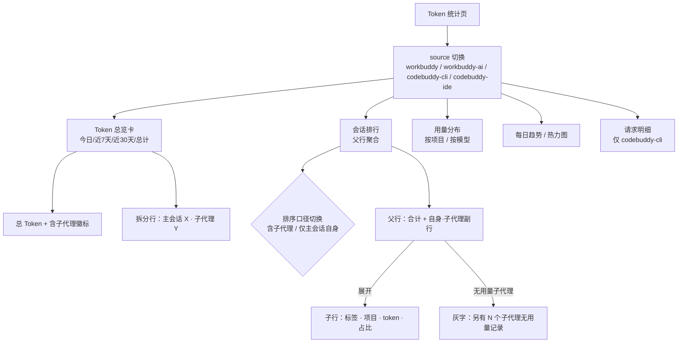

# PRD：Token 统计纳入子代理用量

## 1. 项目信息

| 项 | 内容 |
| --- | --- |
| Language | 中文 |
| Programming Language | 现有技术栈不变：Rust（`crates/wb-switch-core`）+ React/TS + Tailwind/shadcn（`src/`） |
| Project Name | `token_stats_subagents` |
| 涉及模块 | `crates/wb-switch-core/src/modules/token_stats.rs`、`src/pages/TokenStatsPage.tsx`、`src/lib/types.ts` |
| 原始需求复述 | 用户原话：「我既希望把子代理的 token 消耗也纳入统计，也希望能够分别查看主会话和各个子代理各自消耗的 token。」 |

---

## 2. 背景与问题

### 2.1 现状

统计模块 `token_stats.rs` 是统计数据的唯一归属，Tauri `get_token_statistics` 与 HTTP `GET /api/token-stats` 只做转发。当前 `files()` 在遍历目录时**主动跳过名为 `subagents` 的子目录**，代码注释给出的理由是「子代理日志重复父会话上下文，不属于主要用量统计」。

### 2.2 这个假设已经不成立（实测）

对 `~/.workbuddy/projects/**` 的本机核查：

| 核查项 | 结果 |
| --- | --- |
| 主会话与子代理的消息 id 交集 | **0** |
| 两者的 usage 时间戳重叠 | **无重叠** |
| 子代理文件里的 `sessionId` | 自身 `agent-<uuid>`，不是父会话 id |
| 子代理记录里的 `_meta.baggage` | 带 `codebuddy.session_id=<父会话 id>` |

结论：子代理是**独立请求**，不是父历史重放。原注释的假设在当前客户端版本下错误，跳过它们会**系统性少算**。

### 2.3 少算了多少（本机 2026-11-12 当天）

| 口径 | 数值 | 占比 |
| --- | --- | --- |
| 主会话（页面当前显示） | 84.0M | 38.4% |
| 子代理（被排除的部分） | 134.6M | **61.6%** |
| 真实合计 | 218.6M | 100% |

累计口径下差异小得多：主会话 8.85B，子代理约 412M（≈ 4.4%）。**这意味着「今日」档会跳变 +160%，「总计」档只跳变 +4.4%**——用户对账时会强烈感知到不一致，所以口径提示（需求 P0-5）不是可选项。

规模：47 个主会话文件 + 39 个子代理文件；子代理文件里共 2941 条 usage 记录。单个父会话最多挂 **22 个**子代理。

### 2.4 用户痛点

1. 今日总 Token 少算了 61.6%，据此判断「今天很省」会得出错误结论。
2. 子代理往往是**最贵的部分**（单个子代理最高 51.4M，超过当日全部主会话自身消耗的六成），却完全不可见。
3. 即使补上合计，用户仍需要回答「这次任务里，我自己花的和派出去花的各是多少」。

### 2.5 约束（不可破坏）

- 四个 source（`workbuddy` / `workbuddy-ai` / `codebuddy-cli` / `codebuddy-ide`）严格隔离，国际版与国内版不合并。
- 不引入服务端依赖，纯本地扫描、纯本地计算。
- 性能不显著劣化：文件数从 47 → 86（+83%），但子代理记录只占总量的 4.4%，增量成本主要在「开文件」而非「解析」。
- 历史数据不迁移，每次现算。
- 隐私红线不变：不读、不返回消息正文、`reasoning` 正文、工具 `arguments` 原文、认证信息。

---

## 3. 产品目标

| # | 目标 | 可量化验收 |
| --- | --- | --- |
| G1 | 统计口径完整 | 「今日」总 Token 从 84.0M 变为 ≈218.6M；主会话 + 子代理合计与逐文件独立求和误差 < 0.5% |
| G2 | 主会话与子代理可分别查看 | 会话排行中任一主会话可展开看到其每个子代理的独立 token；总览卡可读到「主会话 X · 子代理 Y」两个数 |
| G3 | 排行不被淹没、口径不歧义 | 会话排行默认视图 ≤ 34 行（主会话数量级），不出现「前 10 名全是子代理」；四档范围数字互相可对账（今日 ≤ 近7天 ≤ 近30天 ≤ 总计） |
| G4 | 不劣化性能与隔离 | 86 文件 / 526MB 本机全量扫描仍在秒级；四个 source 的 summary 数值与本次改动前逐位一致（仅 workbuddy/workbuddy-ai 变化） |

---

## 4. 用户故事

1. **As a** 每天看用量判断是否要收敛的开发者，**I want** 「今日总 Token」包含子代理消耗，**so that** 我看到的数字等于我实际被扣费的工作量，而不是只算了我亲手发起的部分。
2. **As a** 用 Agent 团队并行干活的重度用户，**I want** 在会话排行里展开一个主会话就看到它每个子代理各花了多少，**so that** 我能定位是哪一个子代理在烧 token。
3. **As a** 做成本归因的开发者，**I want** 总览卡直接给出「主会话 X · 子代理 Y（Z%）」的拆分，**so that** 我不用自己从两个页面相加。
4. **As a** 关心模型成本的用户，**I want** 模型分布包含子代理的调用，**so that** 我不会因为子代理偷偷用了便宜模型而误判主力模型的成本结构。
5. **As a** 首次升级后对账的用户，**I want** 在总 Token 旁一直看到「含子代理」的标注，**so that** 我不会以为数据出错或重复计算。

---

## 5. 需求池

### 5.1 决策结论（先给结论，需求由此展开）

| # | 问题 | 结论 | 理由 |
| --- | --- | --- | --- |
| D1 | 哪些聚合合并子代理 | **全部合并**：`summary`、`daily`、`dailyByModel`、`hours`、`models`、`projects`、`sessions` | ① `overviewTotals()` 的今日/7天/30天是**从 `daily` 派生**的，`daily` 不合并则四档与 `summary` 自相矛盾，破坏现有不变式；② 模型分布不合并会系统性低估子代理常用的便宜模型；③ 项目归属可无歧义推导（路径首段 + 记录里的 `cwd`），合并无风险。**注意 `total = input + output + cacheWrite`，`input` 已含 `cacheRead`，不得重复加。** |
| D2 | 层级展示主方案 | **①会话列表展开成树** | 用户的真实心智是「一个主会话带若干子代理」，父子关系本身就是要表达的信息；树能同时给出「父行合计」与「子行明细」，一个视图回答两个问题。**不选②类型列+筛选器**：22 个子代理会把列表撑成 5~10 倍长，且筛选后父会话自身的行仍然藏着子代理成本，回答不了「谁最贵」。**不选③单独 Tab**：强迫用户心算两个数相加，且「总 Token 到底含不含子代理」依旧歧义；子代理 Tab 会被 22 行噪音淹没。 |
| D3 | 子代理身份标识 | **主方案：父会话内 `callId` 关联出 `subagent_type` + `description`**（如 `Explore · 查旧版检查项实现`）。**降级阶梯见 P1-3** | 已实测验证：父会话里 `name:"Agent"` 的 `function_call.arguments` 含 `subagent_type` / `description`，同 `callId` 的 `function_call_result.output` 含 `agent-<uuid>`，**`callId` 可关联率 100%**（详见 P1-2 验收：可关联 ≠ 一定有 `subagent_type`，实测 61% 有值，其余按 P1-3 降级）。只取这两个**标量字段**，绝不取同级的 `prompt`（正文，隐私红线）。`description` 与模块已对外暴露的会话 `aiTitle` 属同一隐私等级，口径一致。 |
| D4 | 排行是否被淹没 | **是，且很严重**。父行默认聚合、可展开；不新增「聚合开关」 | 实测：单父会话挂 22 个子代理，单子代理最高 51.4M 而当日主会话自身合计仅 84.0M。`RANKING_LIMIT = 10` 下，扁平混排会让前 10 名几乎全是子代理，主会话全部消失。聚合作为**默认**、展开作为**选项**，比额外一个开关少一个状态位、少一种用户困惑。 |
| D5 | 失败/空子代理 | **隐藏**，但在父行展开区用一行灰字汇总 | `push_session()` 已有 `totals.records == 0` 早退，天然不产生 0 行；完全静默又会让用户怀疑「我的子代理没被统计」。故：不占排行行位，但给出「另有 N 个子代理无用量记录」。 |
| D6 | 口径提示 | **四档范围全部含子代理**；「总 Token」旁常驻 `含子代理` 徽标 + 总览卡底部拆分行 | 四档必须一致（见 D1）。徽标必须常驻而非 hover——这是口径变更，用户会拿旧数字对比。该 source 无子代理数据时（`codebuddy-cli` / `codebuddy-ide`，或国际版无该目录）**不显示徽标与拆分行**，避免暗示「有子代理但为 0」。 |

### 5.2 P0（Must have）

**P0-1 扫描纳入 subagents 目录**

- 移除 `files()` 对 `subagents` 目录的跳过；子代理文件与主会话文件进入同一条解码/去重/聚合管线。
- 子代理记录的 `sessionId` 取文件 stem（`agent-<uuid>`），并额外解析父会话 id（优先取路径中 `subagents` 的上一级目录名，回退到 `_meta.baggage` 里的 `codebuddy.session_id`）。
- **验收**：本机全量扫描 `filesScanned` 从 47 变为 86；`workbuddy.summary.total` 全时段从 8.85B 变为 ≈9.26B；`codebuddy-cli` / `codebuddy-ide` 的 summary 数值逐位不变。

**P0-2 合并口径覆盖全部聚合维度**

- `summary` / `daily` / `dailyByModel` / `hours` / `models` / `projects` / `sessions` 全部包含子代理。
- 保持 `usage_total()` 单一实现，不在子代理路径上另开口径。
- **验收**：`今日` 档显示 ≈218.6M；且 `今日 ≤ 近7天 ≤ 近30天 ≤ 总计` 恒成立（子代理无「未来时间戳」时）；独立脚本逐文件求和与 `summary.total` 误差 < 0.5%。

**P0-3 会话数据带父子关系**

- `sessions` 每项新增：`kind: "main" | "subagent"`、`agentId?`、`parentSessionId?`、`parentKey?`。
- 输出仍为**扁平数组**，由前端组树（避免后端嵌套破坏「按父会话取前 N」的语义）。
- **验收**：任一子代理项都能定位到唯一父会话项；父会话项 `kind = "main"` 且 `parentKey` 为空。

**P0-4 会话排行改为「父行聚合 + 可展开树」**

- 父行：会话标题 + 项目 + **合计** token + 占比；副行显示「自身 X · 子代理 Y（N 个）」。
- 展开后：子行按 token 降序，缩进一级，显示 `标签 · 项目` 与自身 token / 占比。
- **默认折叠**；提供「展开全部 / 收起全部」。
- **关键实现约束**：必须先组树再 `slice(0, RANKING_LIMIT)`。现有代码是对扁平数组 `slice`，直接沿用会把某个父会话的子行切掉一半，出现「父行合计 91.5M 但只列出 1 个子代理」的错误。
- **验收**：展开行 token 之和 + 父行「自身」= 父行合计（允许 0 误差）；一个挂 22 个子代理的父会话，默认视图只占 1 行。

**P0-5 口径提示**

- 「总 Token」指标标签旁常驻徽标 `含子代理`。
- 总览卡底部增加一行拆分：`主会话 84.0M · 子代理 134.6M（61.6%）`，随四档范围联动。
- 无子代理数据的 source 不显示徽标与拆分行。
- **验收**：切换四档，拆分行的两个数之和恒等于「总 Token」；`codebuddy-cli` 页面无徽标。

### 5.3 P1（Should have）

**P1-1 排行排序口径切换**

- 排行标题右侧提供 `含子代理（默认） / 仅主会话自身` 二选一。
- 理由：D4 解决了「被淹没」，但「我自己亲手花了多少」是另一个真实问题（主会话自身 84.0M vs 合计 218.6M，差 2.6 倍）。
- **验收**：切到「仅主会话自身」后，父行数字等于该会话不含子代理的 token，且顺序按该值重排。

**P1-2 子代理可读标签**

- 后端在解析父会话文件时，按 `callId` 关联 `Agent` 工具的 `function_call.arguments.subagent_type` 与 `.description`，为子代理项填 `agentType` / `agentLabel`。
- **只取这两个字段**；`description` 截断至 24 字符；`prompt`、`content`、`reasoning`、`output` 一律不读不返回。
- 后端只读 `arguments` 的这两个白名单 key，**不得**把 `arguments` 原串放进任何响应。
- **验收**：本机实测 41 个子代理，**`callId` 可关联率 100%**（父会话里的 `task_id` 与子代理文件 stem 逐字相等），但 **`agentType` 只有 25 个有值（61%）**——剩下 16 个不是关联失败，而是父会话数据本身缺字段：抽查一个父会话，23 条 `Agent` 调用里有 **4 条 `arguments` 没有 `subagent_type` 键**、**1 条 `arguments` 是非法 JSON**。这些按 P1-3 设计落到第 3 级降级（`子代理 · agent-xxxxxxxx`），**`parseErrors` 仍为 0**。响应体中不存在 `prompt` 字段；关掉该能力后 UI 自动走 P1-3 降级。

**P1-3 身份标识降级阶梯**

按顺序取第一个可用值：

1. `subagent_type · description`（如 `Explore · 查旧版检查项实现`）
2. `subagent_type · agent-<uuid 前 8 位>`
3. `子代理 · agent-<uuid 前 8 位>`
4. `子代理 #n`（父会话内按文件 mtime 升序的序号）

- 降级触发：父日志缺失、父日志已被 fork 去重、旧版客户端不写 `Agent` 工具调用、`arguments` 解析失败。
- **不做可配置**：不引入设置项，避免为极少见的场景增加产品复杂度；序号稳定即可。
- **验收**：删除父日志文件后，子代理仍显示为第 3 级标签且不报错、不产生 `parseErrors`。

**P1-4 空子代理提示**

- 父行展开区末尾追加灰字：`另有 N 个子代理无用量记录`；N = 该父会话下存在但 0 条 usage 的子代理文件数。
- **验收**：造一个空 `agent-xxx.jsonl`，排行不新增行，父行展开区出现该提示。

**P1-5 请求明细标注来源（仅 `codebuddy-cli`）**

- 该 source 目前无 subagents 目录，此项为前瞻：若将来出现，明细行需带「主会话 / 子代理」标记。
- **验收**：当前版本无行为变化。

### 5.4 P2（Nice to have）

**P2-1 子代理数量与文件数指标**

- `summary` 增加 `subagentFiles`、`subagentSessions`；总览卡可选展示「39 个子代理 / 22 个父会话最大」。
- 用于让用户感知扫描规模，也便于性能问题排查。

**P2-2 去重指纹交叉校验**

- 现状 `seen` 指纹为 `(timestamp, input, output, read, write, model)`，跨文件共享。子代理与主会话混入同一 `seen` 后理论上存在「不同请求恰好同指纹被误去重」的风险（实测消息 id 交集 0、时间戳无重叠，风险可忽略）。
- 建议**不改指纹**（加 agent id 会破坏 fork 副本的去重），改为在 `parseErrors` 旁增加一个只读诊断计数：跨文件命中去重次数，便于日后验证。

**P2-3 趋势图按主/子分层堆叠**

- 每日堆叠柱当前按 token 类型分段；可增加「按主会话/子代理」的第二种分段切换。

---

## 6. UI 设计稿

### 6.1 总览卡（新增徽标 + 拆分行）

```
┌ Token 总览 ────────────────────────────────────────────────────────────────────┐
│ [██████████▓▓▓░░░░]  缓存 68% · 新增 12% · 输出 15% · 写入 5%                   │
│                                        [今日] [近7天] [近30天] [总计]           │
├────────────────────────────────────────────────────────────────────────────────┤
│   ▣ 总 Token        ▣ 输入 Token      ▣ 输出 Token       ▣ 缓存命中率           │
│   218.6M            204.1M            12.4M              68.3%                  │
│   (含子代理)  ← 常驻徽标                                                        │
├────────────────────────────────────────────────────────────────────────────────┤
│   主会话 84.0M  ·  子代理 134.6M（61.6%）        ← 随四档联动，两数之和 = 总 Token │
└────────────────────────────────────────────────────────────────────────────────┘
```

无子代理的 source（`codebuddy-cli` / `codebuddy-ide`）不渲染徽标与最后一行。

### 6.2 会话排行（主方案：父行聚合 + 可展开树）

```
┌ 消耗最高的会话 ─────────────────────── [含子代理 ●| 仅主会话自身 ○] ──────────┐
│ 按本地聚合 Token 从高到低排列；主会话行含其子代理。                            │
│                                                                              │
│ 01 ▾ 修复面板停靠与步骤编辑                    9709836e · workbuddy-switch    │
│      自身 10.0M · 子代理 81.5M（5 个）                        91.5M    41.9%  │
│      │ ├ Explore · 查旧版检查项实现                           51.4M    23.5%  │
│      │ ├ Explore · 查新链路检查项实现                         30.1M    13.8%  │
│      │ ├ software-engineer · 实现步骤编辑面板四种停靠           2.6M     1.2%  │
│      │ └ 另有 2 个子代理无用量记录                              （灰字）      │
│                                                                              │
│ 02 ▸ 数据看板重构                              ad7fc377 · apitest            │
│      自身 20.0M · 子代理 25.0M（22 个）                       45.0M    20.6%  │
│                                                                              │
│ 03 ▸ 权限校验重构                              f7b5d1d9 · apitest            │
│      自身 24.0M · 子代理 15.0M（8 个）                        39.0M    17.8%  │
│                                                                              │
│ 04 ▸ …（其余主会话，默认折叠）                                               │
│                                                                              │
│ 共 34 个主会话 · 39 个子代理                    [展开全部]  [收起全部]        │
└──────────────────────────────────────────────────────────────────────────────┘
```

视觉规则：

- `▸ / ▾` 为展开控件，仅 `kind = "main"` 且子代理数 > 0 时出现。
- 子行缩进 1 级，`·` 前缀用 `text-muted-foreground`，token 列与父行右对齐一致。
- 父行副行「自身 X · 子代理 Y（N 个）」用 11px 灰字；只有自身无子代理时不显示副行。
- 占比分母统一为「该 source 当前档位的 summary.total」，与现有 `denominator` 一致。

### 6.3 层级与筛选器位置（Mermaid）



### 6.4 关键交互

| 交互 | 行为 |
| --- | --- |
| 点击父行 `▸` | 展开该父会话子行；状态在本次会话内保留（不持久化，避免跨刷新出现「记忆的展开态」与数据不一致） |
| 展开全部 | 展开当前前 10 个父会话的子行；**不**展开第 11 名以后 |
| 切换排序口径 | 父行 token 与顺序重排；展开态保留 |
| 切换四档范围 | 徽标不变；拆分行两数联动更新 |
| 子代理数 = 0 的父行 | 不显示 `▸`，不显示副行 |

---

## 7. 待确认问题

| # | 问题 | 默认建议 |
| --- | --- | --- |
| Q1 | 子代理的**项目归属**是否沿用父会话？目前子代理记录自带 `cwd`（实测 361/362 条有值），理论上可能和父会话不同项目（例如子代理在另一个仓库干活）。 | **沿用记录自带 `cwd`**，与主会话规则完全一致；不做「强制继承父项目」。理由：与现有 `record_project()` 单一规则一致，避免出现两套归属逻辑；差异案例极少，若用户反馈再议。 |
| Q2 | 「总计」档包含子代理后，用户历史对账会出现 +4.4% 的跳变（8.85B → 9.26B），是否需要在首次升级后弹一次说明？ | **不弹窗**，只靠常驻徽标 + 拆分行。弹窗是一次性成本，徽标是长期解释，后者覆盖更全。 |
| Q3 | `filesScanned` 语义变化（47 → 86）会让「已扫描 N 个会话文件」的文案含义变宽，是否需要拆分？ | **P2 拆分**为 `filesScanned`（总）+ `subagentFiles`；P0 阶段接受语义变宽，不阻塞。 |
| Q4 | 子代理 `description` 是用户手写的任务标签，可能包含敏感信息（如内部项目代号）。是否应该默认不展示、改由设置项开启？ | **默认展示**，理由同 `aiTitle` 已在展示；若后续有合规要求，再加「隐藏子代理标签」设置项。`prompt` 无论如何不读。 |
| Q5 | 排行「展开全部」是否需要把前 10 名之外的父会话也列出来（分页/查看更多）？ | **不做**。当前 `RANKING_LIMIT = 10` 是既有产品决定，子代理问题不改变「只看前 10」的定位；用户要全量可用请求明细或后续分页功能解决。 |

---

## 8. 不在本次范围

- 子代理的**实时/流式**统计（仍是每次请求现算）。
- 子代理与父会话的**时间线对齐视图**（甘特图）。
- 积分（`credit`）口径的页面展示——后端已能读到 `providerData.rawUsage.credit`，但官方积分是账号级按日按模型，与本地 token 无法一一对应，另立需求。
- `codebuddy-cli` / `codebuddy-ide` 的子代理支持（目前这两个 source 不写 `subagents` 目录）。
